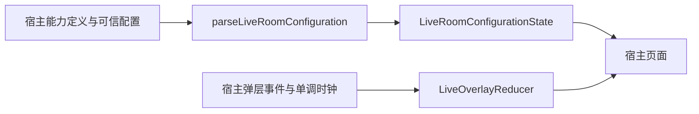

# 直播房间配置与弹层

`live-room-core` 是独立 SDK 中立产物，源码从宿主公共模块迁移，保留 `com.dgtang.live.room` 包名和行为。
它不依赖 `live-core`、`live-kuikly`、AtomicX、腾讯 IM、Kuikly 或 Compose runtime；仅公开依赖 serialization JSON。
业务开关、鉴权、路由、远端配置请求、窗口 owner 与页面仍由宿主持有。

## 接入与数据流

Maven 正式版本坐标为 `com.github.gycrosskit.live-sdk:live-room-core:1.1.3`，待发布；旧渠道版本与 Pod/HAR 不变。

```kotlin
commonMain.dependencies {
    api("com.github.gycrosskit.live-sdk:live-room-core:1.1.3")
}
```



配置只覆盖已注册能力；未知插件与不支持的展示方式不能扩展本地能力。坏插件局部回退，合法空列表只隐藏可选入口，不代替业务权限。
每次进房创建新的 `LiveRoomConfigurationState`；`roomId` 与递增 `revision` 拒绝旧房间、旧快照。活动配置不持久化。
`LiveOverlayReducer` 保留单调时钟过期、同 key 替换、优先级抢占、可恢复队列、终态清空与移除后的到达顺序；宿主负责业务有效性与展示。

源码目标 Android（minSdk 24 / Java 11）、JVM（Java 11）、iOS arm64/x64/Simulator arm64、OHOS arm64。
Kotlin `2.2.21-1.0.0`、serialization `1.9.1-1.0.0` 与宿主保持一致；本产物不要求安装原生 SDK/Renderer 或新增 Pod/HAR。

## 验证与发布合同

保留迁移前的 `LiveRoomConfigurationTest`、`LiveOverlayTest`，包括队列过期、旧房间/版本隔离与错误输入回退。
独立消费者在 `verification/room-consumer`，默认从 JitPack 解析，候选可明确提供 `-PliveMavenRepo=<staging URL>`；`-PremoteOnly` 强制公开仓库，无源码替换/MavenLocal。
该消费者使用 `jvmTest` 检查公开产物的过期/归属规则，`verifyNoTencentSdk` 在完整 Android 依赖图上拒绝腾讯 SDK 与 UI runtime，并编译 Android/iOS/OHOS 公共 API。
源码、SDK 编译/运行回归、候选归档、公开下载和设备行为分别验收，本轮迁移准备不代表这些检查已通过。

生产归档使用现有 `scripts/archive-prebuilt.sh`，新版完整集合为 19 项：既有两模块各六项，加本模块 root/Android/JVM/三种 iOS/OHOS 七项。
`scripts/maven-publications.py` 对 `1.1.3`（含 RC）及后续版本启用新集合；旧标签继续原有 12 项，不修改历史摘要与归档。
归档、metadata、四种哈希和公开消费检查沿用现有模板与统一 `ci.py component-run`，不新增发布渠道。
